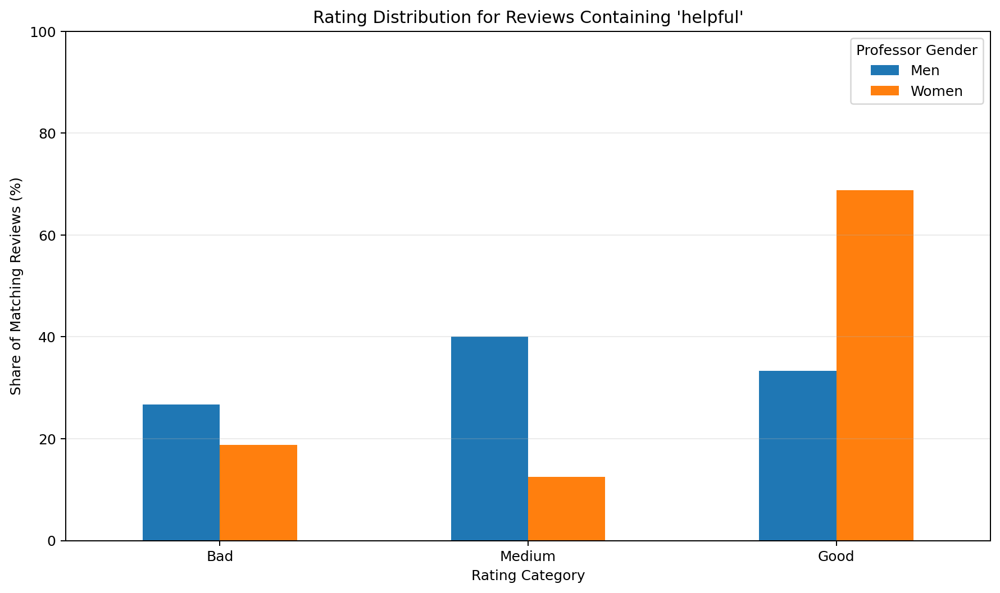
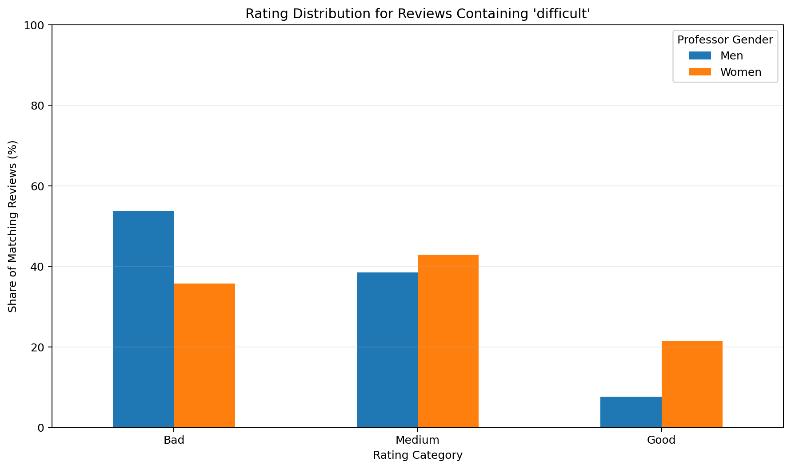
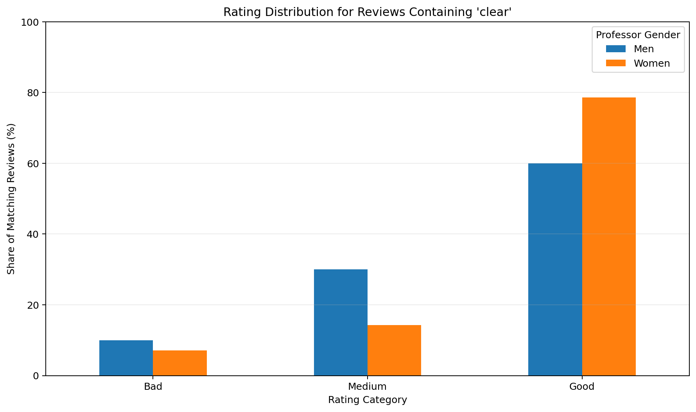

# Bias in Data Analysis

A Python statistical-analysis project that explores whether review language is associated with different rating distributions across professor gender groups.

This portfolio version extends an earlier keyword-analysis concept into a more technical and reproducible workflow using **pandas, SciPy, statistical hypothesis testing, effect-size measurement, normalized comparisons, and automated visualization**.

> **Important:** The included `sample_ratings.csv` is fully synthetic demonstration data created for this portfolio repository. It is designed to exercise the analysis pipeline and should not be interpreted as evidence about real professors, real institutions, or real-world gender bias.

## Dashboard Preview

### "Helpful"


### "Difficult"


### "Clear"


## What the Project Does

Given a CSV containing ratings, gender labels, and review text, the program:

- searches comments for a complete target word using case-insensitive regular expressions
- classifies matching reviews into Bad, Medium, and Good rating groups
- compares rating distributions across gender groups
- normalizes results into within-group percentages
- performs a chi-square test of independence
- calculates Cramer's V to quantify association strength
- exports analysis-ready CSV summaries
- generates presentation-ready comparison charts

## Why Normalized Percentages Matter

Raw counts can be misleading when groups contain different numbers of reviews.

This project therefore compares the **share of matching reviews within each group**, rather than simply comparing totals. That makes the analysis easier to interpret when group sizes differ.

## Statistical Methods

### Chi-Square Test of Independence

The chi-square test evaluates whether the observed rating-category distribution differs across groups more than would be expected by chance under independence.

### Cramer's V

Cramer's V provides an effect-size measure for the association between gender group and rating category.

A small p-value can indicate statistical evidence of a difference, while Cramer's V helps describe whether that difference is weak or strong.

Neither statistic establishes causality.

## Tech Stack

- Python
- pandas
- SciPy
- matplotlib
- regular expressions
- command-line argument parsing

## Project Structure

```text
bias-in-data-analysis/
│
├── bias_analysis.py
├── sample_ratings.csv
├── requirements.txt
├── .gitignore
├── README.md
├── screenshots/
│   ├── helpful_rating_distribution.png
│   ├── difficult_rating_distribution.png
│   └── clear_rating_distribution.png
└── output/
```

## Input Format

The program expects:

```text
rating,gender,comment
```

Example:

```csv
rating,gender,comment
4.8,F,"Very helpful and clear explanations."
2.1,M,"Difficult course with weak support."
```

Supported demonstration gender codes:

- `M` = Men
- `F` or `W` = Women

## Installation

```bash
py -m pip install -r requirements.txt
```

## Usage

Analyze reviews containing `helpful`:

```bash
py bias_analysis.py --input sample_ratings.csv --word helpful
```

Try another keyword:

```bash
py bias_analysis.py --input sample_ratings.csv --word difficult
```

or:

```bash
py bias_analysis.py --input sample_ratings.csv --word clear
```

## Generated Output

Each run creates:

```text
output/
├── <word>_rating_distribution.png
└── <word>_summary.csv
```

The CSV contains:

- target word
- gender group
- rating category
- raw count
- within-group percentage
- chi-square statistic
- p-value
- Cramer's V

## Why the Synthetic Dataset Is Structured This Way

The demonstration dataset intentionally contains **different rating distributions for different keywords and groups**.

That is not meant to simulate a factual real-world result. It is designed to verify that the analysis pipeline can correctly detect and visualize differences when they exist.

A perfectly balanced synthetic dataset would make the comparison chart visually identical across groups and would do a poor job of demonstrating the program's analytical behavior.

## Analytical Limitations

Keyword-based comparisons are only exploratory.

A serious real-world analysis would need to account for confounders such as:

- course subject
- course level and difficulty
- instructor rank
- review volume
- institution
- time period
- reviewer self-selection
- text sentiment beyond a single keyword
- multiple-testing corrections across many searched terms

The analysis should therefore be interpreted as a pattern-detection workflow rather than proof of discrimination or causality.

## Skills Demonstrated

- data cleaning and validation
- text analysis with regular expressions
- normalized group comparisons
- statistical hypothesis testing
- effect-size measurement
- exploratory data analysis
- visualization
- reproducible CLI workflows
- responsible interpretation of analytical results
